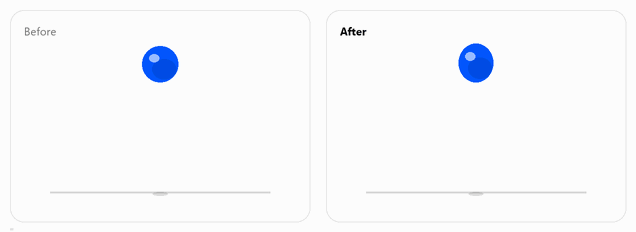
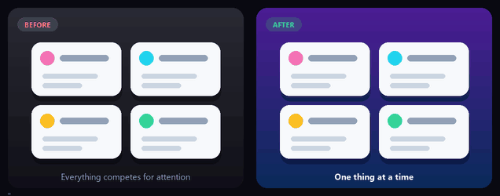
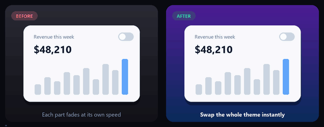
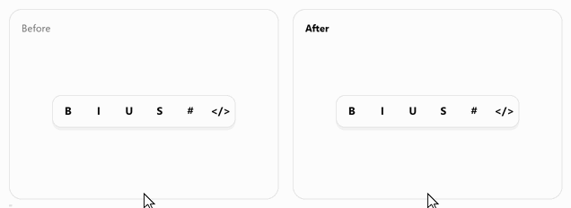
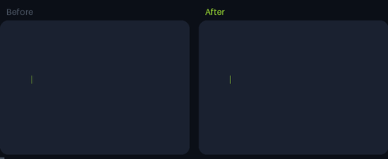
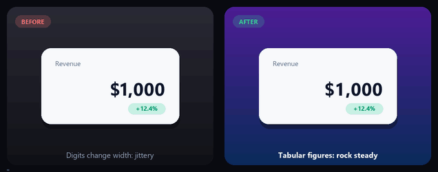
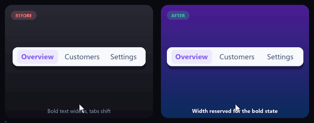

# uidesignupgrade

A Claude Code skill that upgrades an app or website UI using a growing library of UX, animation, typography and "un-slop" principles. The ones that need motion to explain are shown below as before/after GIFs.

## Install

As a plugin (recommended, updates with `claude plugin update`):

```sh
claude plugin marketplace add lllons/uidesignupgrade
claude plugin install uidesignupgrade@lllons-plugins
```

Or clone it as a standalone skill:

```sh
git clone https://github.com/lllons/uidesignupgrade ~/.claude/skills/uidesignupgrade
```

## Use

In Claude Code, run `/uidesignupgrade:uidesignupgrade` (plugin) or `/uidesignupgrade` (standalone skill), or ask Claude to make a UI feel more polished or responsive. Claude audits the interface against the principles in [SKILL.md](SKILL.md), applies the fixes that fit, and reports what changed.

## Motion and interaction, before and after

| Principle | Before / After |
|-----------|----------------|
| **Exaggeration**: push feedback further than real life<br>Before: Fails quietly. After: Shake + red: impossible to miss. |  |
| **Origin awareness**: grow out of what was tapped<br>Before: Pops in from nowhere. After: Grows out of the button. |  |
| **Scale from 0.97, not 0**: settle in, don't zoom from a dot<br>Before: Zooms up from a dot. After: Scale from 0.97 + fade. |  |
| **Staggering**: one after another, not all at once<br>Before: Everything at once. After: One after another. |  |
| **Squash and stretch**: soft, not stiff<br>Before: Rigid, like a rock. After: Squash on impact, stretch in flight. |  |
| **Rubber banding**: stretch past the end, spring back<br>Before: Hard stop at the edge. After: Stretches, then springs back. |  |
| **Anticipation**: a small wind-up first<br>Before: Just leaves. After: Winds up, then goes. |  |
| **Staging**: one thing at a time<br>Before: Everything competes for attention. After: One thing at a time. |  |
| **Slow in, slow out**: ease, never linear<br>Before: Linear: robotic. After: Ease in, ease out: natural. |  |
| **Follow-through**: details settle a beat later<br>Before: Everything stops dead. After: Details settle a beat later. |  |
| **Arcs**: move in curves, not straight lines<br>Before: Straight lines: mechanical. After: Curved paths: natural. |  |
| **Secondary action**: a small extra motion backs up the main one<br>Before: Heart just turns red. After: Pop, burst and count roll. |  |
| **Timing**: short durations for routine UI<br>Before: Sluggish: you wait for it. After: Snappy: ready when you are. |  |
| **Interruptible motion**: a tap reverses it mid-way<br>Before: Ignores the tap, finishes first. After: Reverses the moment you tap. |  |
| **Directional transitions**: Next slides left, Back slides right<br>Before: Every step just fades. After: Next slides left, Back slides right. |  |
| **Animate to auto height**: accordions open smoothly<br>Before: Snaps open, rows jump. After: Animates to its natural height. |  |
| **Instant theme switches**: no mismatched fades<br>Before: Each part fades at its own speed. After: Swap the whole theme instantly. |  |
| **Tooltip delay only once**: then instant<br>Before: Waits 600 ms on every button. After: Skips the delay once one is open. |  |
| **Frequency of use**: skip animation for frequent actions<br>Before: Animates every switch: laggy. After: Instant: you do this all day. |  |
| **Peak-end rule**: end on a win<br>Before: Ends flat. After: Ends on a win. |  |

Also in the skill: pose to pose, transform-not-layout animation, velocity-matched springs, shared element transitions, optimistic updates, useful feedback and appeal.

## UX laws and layout, before and after

| Principle | Before / After |
|-----------|----------------|
| **Doherty threshold**: respond in under 400 ms<br>Before: Nothing happens for 1.2 s. After: Instant feedback. |  |
| **Fitts's law**: bigger and closer is faster to hit<br>Before: Small and far away. After: Big and close to the cursor. |  |
| **Hick's law**: fewer choices, faster picks<br>Before: 9 choices: slow to scan. After: 4 choices: quick pick. |  |
| **Von Restorff effect**: make the pick stand out<br>Before: Nothing stands out: users hesitate. After: The pick stands out. |  |
| **Layout shift**: reserve space so nothing jumps<br>Before: Image loads, button jumps away. After: Space reserved, nothing moves. |  |

Also in the skill: bigger hit areas, Miller's law, Postel's law, Jakob's law, progressive disclosure, affordance, safe areas, comboboxes, concentric radii (inner = outer − padding), grouping with spacing and optical alignment.

## Typography, before and after

| Principle | Before / After |
|-----------|----------------|
| **Tabular numbers**: digits that don't jitter<br>Before: Digits change width: jittery. After: Tabular figures: rock steady. |  |
| **Reserved bold width**: bold states don't shift the row<br>Before: Bold text widens, tabs shift. After: Width reserved for the bold state. |  |

Also in the skill: kerning, tracking, leading, x-height, line length, widows, text-box trim, underline offset, superscript spacing, fluid type with `clamp()`, small caps for acronyms, curly quotes, middle truncation, auto hyphenation, line-clamped titles, OKLCH colour and text contrast.

## Beyond motion

The skill also covers:

- **Fonts by feeling**: Swiss, friendly, personality, techy, vintage, modern serif, soft serif and fun picks, plus the fonts that make a site look AI-generated.
- **Un-slop checklist**: removing the generic AI look (filler badges, random italics, decorative mono, purple gradients, vague headlines, missing states).
- **App Store screenshots**: brand colour, one idea per headline, a continuous visual across frames, a hook split over the first two slides, social proof.
- **Worked example**: turning a generic password screen into a calm, secure and characterful one.

The GIFs are generated by [`assets/make_gifs.py`](assets/make_gifs.py) (needs Pillow). Principles that read clearly as text don't get one.

## Adding a principle

1. Add it to the right section in [SKILL.md](SKILL.md).
2. If it needs a demo, add a draw function to [`assets/make_gifs.py`](assets/make_gifs.py), append it to `PRINCIPLES`, run `python assets/make_gifs.py <function_name>`, and add a row to the matching table above.
3. Bump `version` in [`.claude-plugin/plugin.json`](.claude-plugin/plugin.json) so plugin users get the update.

## License

[Apache License 2.0](LICENSE)
