> **Agents: refer to [agents.setup.md](agents.setup.md)** for setup instructions.

<p align="center">
  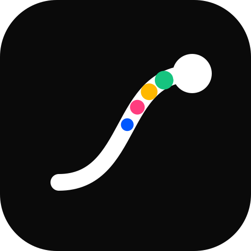
</p>

<h1 align="center">uidesignupgrade</h1>

<p align="center">UX laws, motion, typography and colour for any coding agent.</p>

<p align="center">
  <a href="https://www.npmjs.com/package/uidesignupgrade"></a>
  <a href="https://github.com/lllons/uidesignupgrade/releases"></a>
  <a href="LICENSE"></a>
  
</p>

https://github.com/user-attachments/assets/7c6a4b6f-c6a2-4f63-a969-7073538e783b

An [Agent Skill](https://agentskills.io) that upgrades an app or website UI using a growing library of UX, animation, typography, colour and "un-slop" principles. It works with Claude Code, Codex, Gemini CLI, GitHub Copilot, OpenCode, Cursor and any other agent that reads `SKILL.md`. The principles that need motion to explain are shown below as before/after GIFs.

## Install

Pick your agent. Each installs at user level (available in every project).

**Claude Code** (as a plugin, updates with `claude plugin update`):

```sh
claude plugin marketplace add lllons/uidesignupgrade
claude plugin install uidesignupgrade@lllons-plugins
```

**Gemini CLI:**

```sh
gemini skills install https://github.com/lllons/uidesignupgrade.git --consent
```

**Codex, GitHub Copilot and OpenCode** (all read `~/.agents/skills`):

```sh
git clone https://github.com/lllons/uidesignupgrade "$HOME/.agents/skills/uidesignupgrade"
```

**npx** (Claude Code, Codex, Gemini CLI, Copilot and OpenCode by default; add `--agent all` for Cursor too, or `--project` for the current project only):

```sh
npx uidesignupgrade
```

**Gemini CLI extension:**

```sh
gemini extensions install https://github.com/lllons/uidesignupgrade
```

**Any agent, including Cursor** ([skills CLI](https://github.com/vercel-labs/skills), supports 70+ agents; needs Node.js 22.20+):

```sh
npx skills add lllons/uidesignupgrade -g
```

**Manual:** clone the repo into your agent's skills folder: `~/.claude/skills/` (Claude Code), `~/.agents/skills/` (Codex, Gemini CLI, Copilot, OpenCode), `~/.gemini/skills/` (Gemini CLI), `~/.copilot/skills/` (Copilot), `~/.config/opencode/skills/` (OpenCode). For a single project, use the project-level folder instead (for example `.agents/skills/` or `.claude/skills/`).

To update a cloned install, run `git pull` inside the folder.

## Use

Run the skill (`/uidesignupgrade` in Claude Code, or `/uidesignupgrade:uidesignupgrade` when installed as a plugin; Codex: `$uidesignupgrade`), or just ask your agent to make a UI feel more polished, fix its typography, or make it look less AI-generated. The agent audits the interface against the index in [SKILL.md](SKILL.md), reads the detailed [references](references/) for each area it touches, applies the fixes that fit, and reports what changed.

<p align="center">
  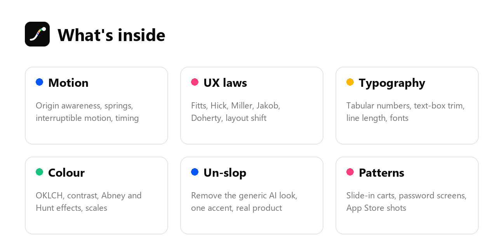
</p>

It picks a mode from your request (full upgrade, audit only, one area, new build, screenshot critique, PR review or un-slop), so "audit my UI" won't edit files and "fix the typography" won't redesign the page.

| Reference | Covers |
|-----------|--------|
| [audit.md](references/audit.md) | how the agent runs: finding your design system, ready-made search commands, priority levels, verification and the report |
| [platforms.md](references/platforms.md) | the common fixes in Tailwind, Framer Motion, SwiftUI, Compose, Flutter and React Native |
| [motion.md](references/motion.md) | every motion principle with tokens, code, mistakes and checks |
| [ux-laws.md](references/ux-laws.md) | UX laws, layout, hit areas, layout shift, Gestalt principles |
| [typography.md](references/typography.md) | type details with CSS, plus fonts by feeling |
| [color.md](references/color.md) | 20 colour terms and a working OKLCH colour system |
| [unslop.md](references/unslop.md) | the checklist for removing the generic AI look |
| [patterns.md](references/patterns.md) | add-to-cart, sign-up/password, App Store screenshots, pricing |

## Motion and interaction, before and after

| Principle | Before / After |
|-----------|----------------|
| **Exaggeration**: push feedback further than real life<br>Before: Fails quietly. After: Shake + red: impossible to miss. |  |
| **Origin awareness**: grow out of what was tapped<br>Before: Pops in from nowhere. After: Grows out of the button. | 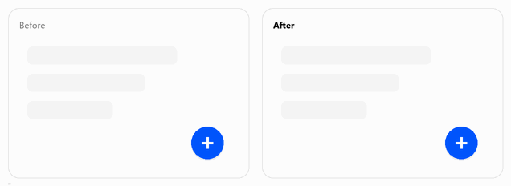 |
| **Scale from 0.97, not 0**: settle in, don't zoom from a dot<br>Before: Zooms up from a dot. After: Scale from 0.97 + fade. | 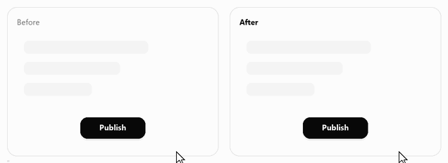 |
| **Staggering**: one after another, not all at once<br>Before: Everything at once. After: One after another. |  |
| **Squash and stretch**: soft, not stiff<br>Before: Rigid, like a rock. After: Squash on impact, stretch in flight. |  |
| **Rubber banding**: stretch past the end, spring back<br>Before: Hard stop at the edge. After: Stretches, then springs back. | 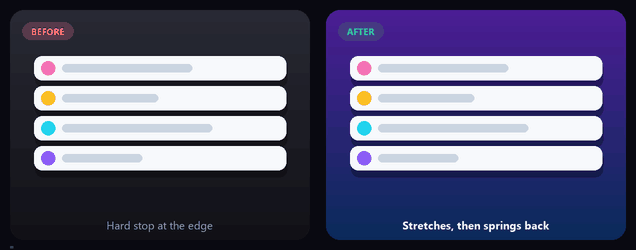 |
| **Anticipation**: a small wind-up first<br>Before: Just leaves. After: Winds up, then goes. | 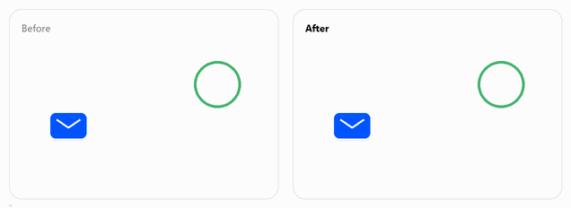 |
| **Staging**: one thing at a time<br>Before: Everything competes for attention. After: One thing at a time. |  |
| **Slow in, slow out**: ease, never linear<br>Before: Linear: robotic. After: Ease in, ease out: natural. |  |
| **Follow-through**: details settle a beat later<br>Before: Everything stops dead. After: Details settle a beat later. |  |
| **Arcs**: move in curves, not straight lines<br>Before: Straight lines: mechanical. After: Curved paths: natural. |  |
| **Secondary action**: a small extra motion backs up the main one<br>Before: Heart just turns red. After: Pop, burst and count roll. |  |
| **Timing**: short durations for routine UI<br>Before: Sluggish: you wait for it. After: Snappy: ready when you are. |  |
| **Interruptible motion**: a tap reverses it mid-way<br>Before: Ignores the tap, finishes first. After: Reverses the moment you tap. | 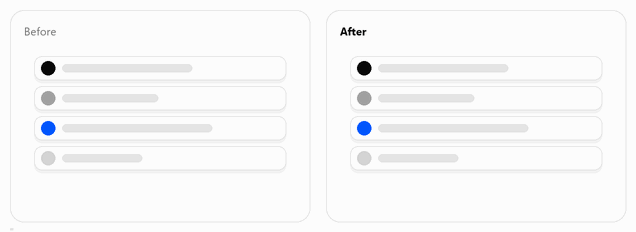 |
| **Directional transitions**: Next slides left, Back slides right<br>Before: Every step just fades. After: Next slides left, Back slides right. | 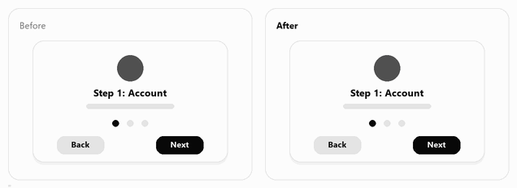 |
| **Animate to auto height**: accordions open smoothly<br>Before: Snaps open, rows jump. After: Animates to its natural height. | 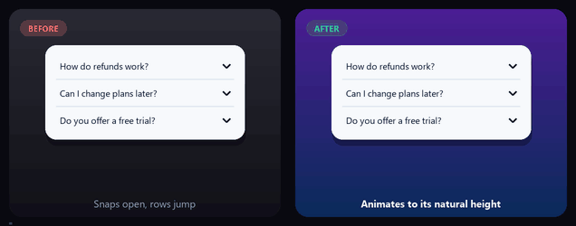 |
| **Instant theme switches**: no mismatched fades<br>Before: Each part fades at its own speed. After: Swap the whole theme instantly. |  |
| **Tooltip delay only once**: then instant<br>Before: Waits 600 ms on every button. After: Skips the delay once one is open. |  |
| **Frequency of use**: skip animation for frequent actions<br>Before: Animates every switch: laggy. After: Instant: you do this all day. |  |
| **Peak-end rule**: end on a win<br>Before: Ends flat. After: Ends on a win. |  |

Also in the skill: pose to pose, transform-not-layout animation, velocity-matched springs, shared element transitions, optimistic updates, useful feedback and appeal.

## UX laws and layout, before and after

| Principle | Before / After |
|-----------|----------------|
| **Doherty threshold**: respond in under 400 ms<br>Before: Nothing happens for 1.2 s. After: Instant feedback. | 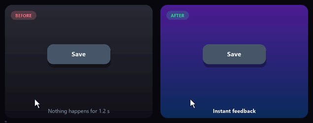 |
| **Fitts's law**: bigger and closer is faster to hit<br>Before: Small and far away. After: Big and close to the cursor. |  |
| **Hick's law**: fewer choices, faster picks<br>Before: 9 choices: slow to scan. After: 4 choices: quick pick. |  |
| **Von Restorff effect**: make the pick stand out<br>Before: Nothing stands out: users hesitate. After: The pick stands out. |  |
| **Layout shift**: reserve space so nothing jumps<br>Before: Image loads, button jumps away. After: Space reserved, nothing moves. | 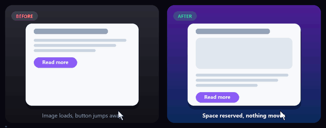 |

Also in the skill: bigger hit areas, Miller's law, Postel's law, Jakob's law, goal-gradient effect, progressive disclosure, affordance, safe areas, comboboxes, concentric radii (inner = outer − padding), grouping with spacing, optical alignment, redundancy gain, continuity and anthropomorphism.

## Typography, before and after

| Principle | Before / After |
|-----------|----------------|
| **Tabular numbers**: digits that don't jitter<br>Before: Digits change width: jittery. After: Tabular figures: rock steady. |  |
| **Reserved bold width**: bold states don't shift the row<br>Before: Bold text widens, tabs shift. After: Width reserved for the bold state. |  |

Also in the skill: kerning, tracking, leading, x-height, line length, widows, text-box trim, underline offset, superscript spacing, fluid type with `clamp()`, small caps for acronyms, curly quotes, middle truncation, auto hyphenation, line-clamped titles and text contrast.

## Patterns, before and after

| Pattern | Before / After |
|---------|----------------|
| **Add to cart**: never pull shoppers away from shopping<br>Before: Jumps to the cart, shopper loses their place. After: Cart slides in and stays: keep shopping or check out. | 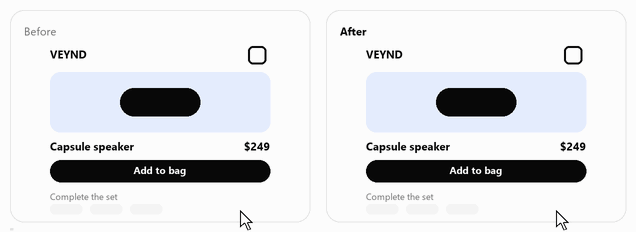 |

Also in the skill: sign-up and password screens, App Store screenshots (from Duolingo and Strava redesigns) and pricing pages.

## Beyond motion

The skill also covers:

- **Colour**: a working OKLCH system plus 20 terms explained for builders (hue, chroma, tint, shade, tone, analogous colours, simultaneous contrast, chromostereopsis, increased contrast mode, gamut, Abney effect, irradiation illusion, Stevens' power law, Hunt effect, Helmholtz–Kohlrausch effect, additive colour, opacity, sequential and diverging scales, relative luminance).
- **Fonts by feeling**: Swiss, friendly, personality, techy, vintage, modern serif, soft serif and fun picks, plus the fonts that make a site look AI-generated.
- **Un-slop checklist**: removing the generic AI look (filler badges, random italics, decorative mono, purple gradients, vague headlines, missing states).

The GIFs are generated by [`assets/make_gifs.py`](assets/make_gifs.py) (needs Pillow). Principles that read clearly as text don't get one.

## License

[Apache License 2.0](LICENSE)
