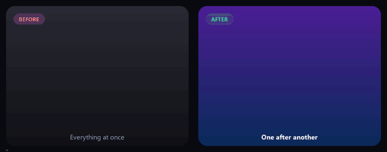
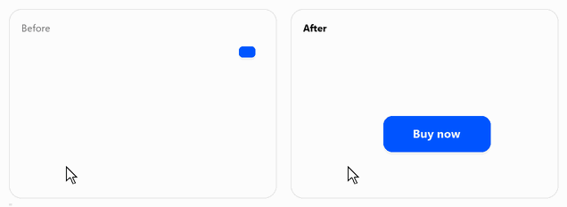
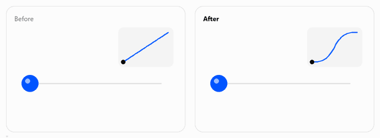
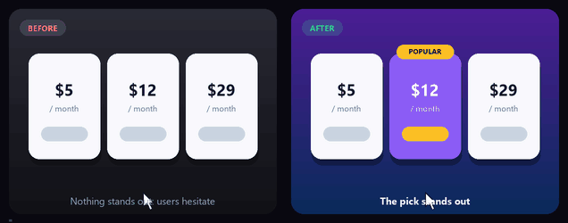
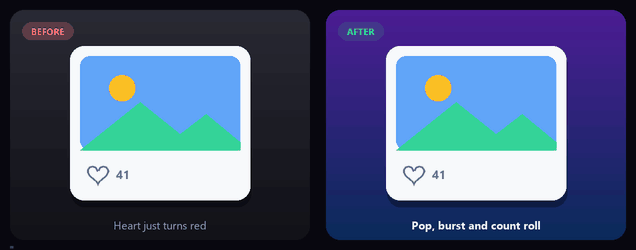

# uidesignupgrade

A Claude Code skill that upgrades an app or website UI using a growing library of UX and animation principles, each shown below as a before/after.

## Install

As a plugin (recommended, updates with `claude plugin update`):

```sh
claude plugin marketplace add lllons/uidesignupgrade
claude plugin install uidesignupgrade@lllons-plugins
```

Or clone it as a standalone skill:

```sh
git clone https://github.com/lllons/uidesignupgrade ~/.claude/skills/uidesignupgrade
```

## Use

In Claude Code, run `/uidesignupgrade:uidesignupgrade` (plugin) or `/uidesignupgrade` (standalone skill), or ask Claude to make a UI feel more polished or responsive. Claude audits the interface against the principles in [SKILL.md](SKILL.md), applies the fixes that fit, and reports what changed.

## The principles, before and after

| # | Principle | Before / After |
|---|-----------|----------------|
| 1 | **Exaggeration**: push feedback further than real life |  |
| 2 | **Origin awareness**: grow out of what was tapped |  |
| 3 | **Staggering**: one after another, not all at once |  |
| 4 | **Squash and stretch**: soft, not stiff |  |
| 5 | **Rubber banding**: stretch past the end, spring back |  |
| 6 | **Doherty threshold**: respond in under 400 ms |  |
| 7 | **Anticipation**: a small wind-up first |  |
| 8 | **Fitts's law**: bigger and closer is faster to hit |  |
| 9 | **Slow in, slow out**: ease, never linear |  |
| 10 | **Hick's law**: fewer choices, faster picks |  |
| 11 | **Follow-through**: details settle a beat later |  |
| 12 | **Arcs**: move in curves, not straight lines |  |
| 13 | **Von Restorff effect**: make the pick stand out |  |
| 14 | **Timing**: short durations for routine UI |  |
| 15 | **Interruptible motion**: a tap reverses it mid-way |  |
| 16 | **Secondary action**: a small extra motion backs up the main one |  |
| 17 | **Frequency of use**: skip animation for frequent actions |  |
| 18 | **Peak-end rule**: end on a win |  |

The GIFs are generated by [`assets/make_gifs.py`](assets/make_gifs.py) (needs Pillow).

## Adding a principle

1. Add it to the list in [SKILL.md](SKILL.md).
2. Add a draw function to [`assets/make_gifs.py`](assets/make_gifs.py), append it to `PRINCIPLES`, and run the script.
3. Add a row to the table above.
4. Bump `version` in [`.claude-plugin/plugin.json`](.claude-plugin/plugin.json) so plugin users get the update.

## License

[Apache License 2.0](LICENSE)
