# uidesignupgrade

A Claude Code skill that upgrades an app or website UI using 18 UX and animation principles: exaggeration, origin awareness, staggering, squash and stretch, rubber banding, Doherty threshold, anticipation, Fitts's law, slow in/slow out, Hick's law, follow-through, arcs, Von Restorff effect, timing, interruptible motion, secondary action, frequency of use and peak-end rule.

## Install

Clone into your Claude Code skills folder:

```sh
git clone https://github.com/lllons/uidesignupgrade ~/.claude/skills/uidesignupgrade
```

## Use

In Claude Code, run:

```
/uidesignupgrade
```

or ask Claude to make a UI feel more polished or responsive. Claude audits the interface against the principles in [SKILL.md](SKILL.md), applies the fixes that fit, and reports what changed.

## The principles, before and after

| # | Principle | Before / After |
|---|-----------|----------------|
| 1 | **Exaggeration**: push feedback further than real life | 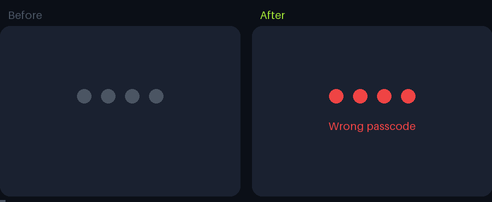 |
| 2 | **Origin awareness**: grow out of what was tapped | 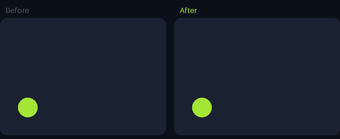 |
| 3 | **Staggering**: one after another, not all at once | 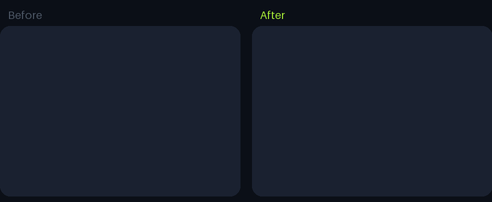 |
| 4 | **Squash and stretch**: soft, not stiff | 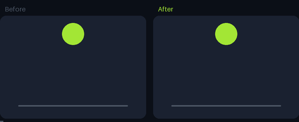 |
| 5 | **Rubber banding**: stretch past the end, spring back | 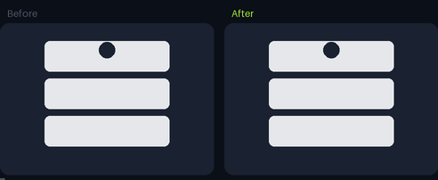 |
| 6 | **Doherty threshold**: respond in under 400 ms | 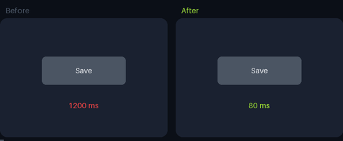 |
| 7 | **Anticipation**: a small wind-up first | 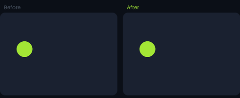 |
| 8 | **Fitts's law**: bigger and closer is faster to hit | 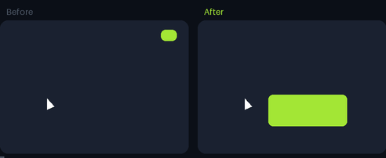 |
| 9 | **Slow in, slow out**: ease, never linear | 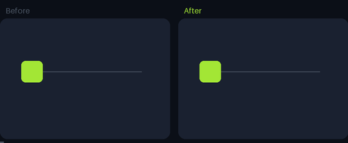 |
| 10 | **Hick's law**: fewer choices, faster picks | 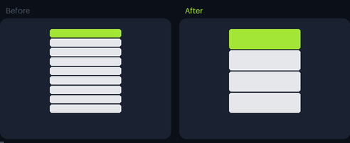 |
| 11 | **Follow-through**: details settle a beat later |  |
| 12 | **Arcs**: move in curves, not straight lines | 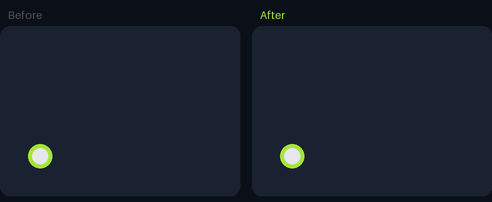 |
| 13 | **Von Restorff effect**: make the pick stand out | 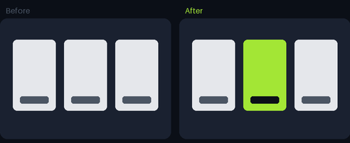 |
| 14 | **Timing**: short durations for routine UI | 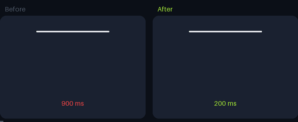 |
| 15 | **Interruptible motion**: a tap reverses it mid-way | 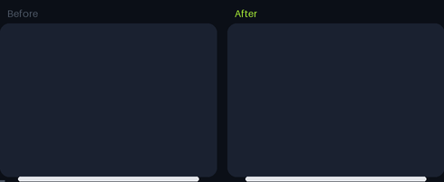 |
| 16 | **Secondary action**: a small extra motion backs up the main one | 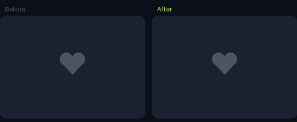 |
| 17 | **Frequency of use**: skip animation for frequent actions | 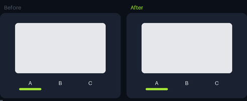 |
| 18 | **Peak-end rule**: end on a win |  |

The GIFs are generated by [`assets/make_gifs.py`](assets/make_gifs.py) (needs Pillow).

## License

[Apache License 2.0](LICENSE)
